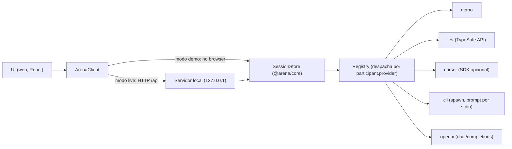

# Arquitetura

A arena separa **regras e estado** (`@arena/core`, TS puro) de **transporte** (cliente no browser ou HTTP) e de **provedores** (quem decide o lance). O mesmo núcleo roda no navegador, no modo demo, e no servidor local.

## Fluxo de decisão

No modo demo, o `ArenaClient` chama `createSessionStore(createDemoAdapter())` direto no navegador, e a análise usa o motor heurístico (`createHeuristicEngine`). No modo live, o `ArenaClient` fala HTTP com o servidor, que usa o mesmo `SessionStore`, mas com o registro de provedores e o Stockfish para análise.

## Componentes

| Peça | Responsabilidade |
|---|---|
| `ArenaClient` (`web/src/client`) | Interface única da UI: `providers`, `createSession`, `getSession`, `decide`, `action`, `exportSession`, `analysis`. `index.ts` escolhe a implementação: `VITE_ARENA_MODE=demo` força demo; senão tenta `GET /api/health` (timeout 1,2 s) e cai em demo se falhar |
| `SessionStore` (`packages/core/src/session.ts`) | Estado da partida: lances legais, relógio, histórico, métricas, custo. Chama o `DecisionAdapter` para cada lance |
| `engine.ts`, `scenarios.ts`, `brief.ts` | Regras de xadrez, cenários e resumo da posição para o prompt |
| `prompt.ts` | `buildMovePrompt`, `buildCorrection`, `parseMoveId`: prompt e leitura de resposta compartilhados pelos provedores de LLM |
| `cost.ts`, `sanitize.ts` | Custo (JEV, estimado, reportado) e sanitização do export |
| `analysis.ts` | Análise da partida sobre um `Engine` (Stockfish no servidor, heurístico no demo) |
| Registry (`server/src/providers/registry.ts`) | Monta um `DecisionAdapter` que despacha por `participant.provider` e recusa provedor indisponível com mensagem clara |
| HTTP (`server/src/http.ts`) | Rotas `/api/*`, estáticos de `web/dist`. Escuta só em `127.0.0.1` |

## Provedores

Cada provedor implementa `ProviderModule` (`id`, `label`, `kind`, `status()`, `models()`, `decide()`, opcionalmente `openSession`/`closeAll`). `status()` diz se está disponível e, se não, por quê, sem expor valores de ambiente. Criar sessão com provedor indisponível devolve 400.

## Dados e fronteira de confiança

- Chaves entram só pelo `.env` do servidor (ou pelo ambiente). Nenhuma resposta HTTP carrega valor de variável de ambiente.
- `arena.config.json` é local e confiável: os `args` das CLIs vêm dele. O prompt nunca é interpolado na linha de comando; vai por stdin.
- O build do Pages (`build:demo`) não referencia `/api`.

Contrato detalhado de rotas, tipos e testes: [SPEC.md](SPEC.md).
